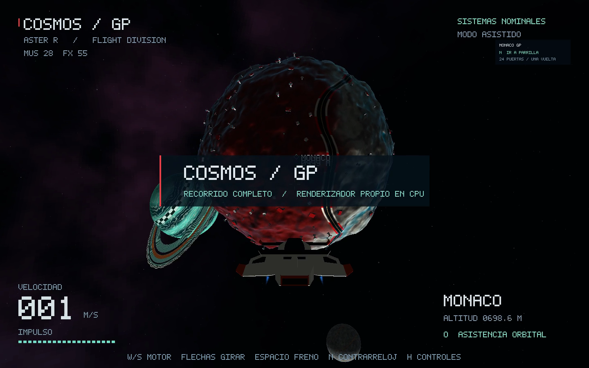

# Proyecto 3: Space Travel

**COSMOS / GP — ASTER R** · Gráficas por computadora · UVG

Explora Mónaco y Rebufo con una nave inspirada en F1. Acércate a sus superficies,
rodea un planeta sin cambiar de escena o entra al contrarreloj de Mónaco.
Todo el mundo tridimensional se dibuja mediante un renderizador propio en CPU.

Proyecto individual de Yehosua F. Hercules, con asistencia de Codex declarada en
[procedencia y contribuciones](docs/PROCEDENCIA.md).



[Ver la demostración de 67 segundos](deliverable/COSMOS_GP_DEMO.mp4) ·
[Guía de defensa](docs/GUIA_DEFENSA.md) · [Criterios de evaluación](docs/CRITERIOS.md)

## Abrir y jugar en este Mac

Desde el repositorio, seguir la compilación indicada abajo. Para producir una
aplicación de doble clic, ejecutar `python3 scripts/build_macos.py` y abrir
**COSMOS GP.app**. El paquete local **PROYECTO_3_SPACE_TRAVEL.zip** también incluye
esa aplicación para Apple Silicon, sus modelos y la pista de F1 proporcionada
por el usuario. No necesita conexión para jugar.
La resolución de cálculo predeterminada es 960 × 600 y la ventana es redimensionable.

- **W** acelera, **flechas** orientan y **Espacio** frena.
- **O**, cerca de un planeta, activa asistencia orbital. **R/F** cambian la altitud.
- **T** desconecta la asistencia para conservar la inercia; **Alt** permite derrapar.
- **N** prepara la parrilla del contrarreloj; esperar las luces y acelerar con W.
- Seguir la puerta verde. Las azules anticipan la trazada. **Borrar** abandona la carrera.
- **H** abre los controles completos. **P** pausa. Al perder el foco, el juego se pausa.

El cronómetro guarda la mejor marca en `session-best.txt` junto a la aplicación.
Entrar a la parrilla con N reposiciona la nave deliberadamente. La exploración libre
es continua: acercarse, rodear y alejarse no carga otra escena.

## Compilar desde el código

Requisitos de desarrollo en macOS: Rust/Cargo, CMake y las herramientas de línea
de comandos de Xcode. Las versiones de las bibliotecas están fijadas en Cargo.lock.

```sh
git clone https://github.com/yehosuah/proyecto3-space-travel.git
cd proyecto3-space-travel
cargo run --release --locked
python3 scripts/build_macos.py
```

La primera compilación obtiene las dependencias de Cargo. Una vez descargadas,
se puede usar `--offline`. El empaquetador construye una aplicación que localiza
sus recursos dentro de `Contents/Resources`, aunque se mueva de carpeta.

## Controles

| Entrada | Acción |
| --- | --- |
| W / S | Acelerar / retropropulsión |
| Flechas | Cabeceo y giro; también botón derecho + mover ratón |
| A / D, R / F | Desplazarse lateralmente, subir / bajar |
| Q / E | Alabeo |
| Shift | Impulso con reserva recargable |
| Espacio / Alt | Frenar / derrapar |
| T / O | Asistencia inercial / control orbital |
| C / Tab | Cámara de seguimiento o frontal / destino |
| N / Borrar | Preparar salida del contrarreloj / exploración libre |
| [ / ] | Bajar / subir volumen de música |
| − / = | Bajar / subir volumen de efectos |
| M | Silencio |
| H / P / U | Ayuda / pausa / visibilidad de instrumentos |
| F3 | Estadísticas de trabajo y ritmo real de la ventana |
| F4 / F5 / F6 | Alternar culling / LOD / mapa de normales |
| G | Alternar gravedad en vuelo libre |
| F8 | Abrir la publicación oficial del tema de F1 en el navegador |
| F12 / Esc | Captura PNG junto a la aplicación / salir |

## Qué incluye

- Dos planetas distintos que orbitan y giran: Mónaco y Rebufo; estrella Cinco Luces,
  luna Auto de Seguridad y anillos.
- Nave Aster R cargada desde OBJ/MTL; perspectiva, clipping de seis planos,
  profundidad e interpolación de atributos propios.
- Hangares, torres de control, antenas y balizas creados por composición de geometría
  en CPU. Distribución reproducible con ruido y semilla configurable en el código.
- Shaders diferenciados, animación temporal, mapa de normales tangente, relieve
  geométrico y varios niveles de detalle.
- Vuelo con inercia, aceleración, freno, impulso, deriva, gravedad y colisiones básicas.
- Contrarreloj de 24 puertas con detección dirigida de cruces y mejor marca persistente.
- Música local, efectos de propulsión sintetizados y señales de carrera.

El alcance de colisión es esférico para los cuerpos celestes; no hay aterrizaje,
movimiento a pie ni colisiones detalladas con cada edificio.

## Verificación

```sh
cargo test --release --locked
cargo clippy --all-targets --locked -- -D warnings
cargo fmt --check
cargo run --release --locked -- --headless --shot superficie --benchmark 100
cargo run --release --locked -- --headless --shot puerto --output renders/puerto.png
cargo run --release --locked -- --headless --shot inicio --benchmark 100 --no-lod --no-culling
```

Vistas: `inicio`, `monaco`, `superficie`, `puerto`, `rebufo`, `anillos`, `circuito`.
`--no-normal-map` permite otra comparación. `--music /ruta/pista.mp3` selecciona
un archivo local alternativo. El juego funciona sin una pista de música.
La grabación local no está versionada en Git; el clon conserva los efectos
sintetizados y admite copiar una pista propia a `assets/audio/local.mp3`.

El benchmark mide renderizado CPU, sin presentación de ventana. Sus FPS teóricos
no son los FPS observados al jugar. Las mediciones y su alcance están en
[VALIDACION.md](docs/VALIDACION.md).

## Video y entrega

El video de 67 segundos muestra vuelo, acercamiento, una vuelta completa y
alejamiento en una única simulación, con rótulos en español y música de fondo.
Se captura a 30 FPS con entradas programadas a la misma física del juego; no es
una medición de FPS ni una grabación de pilotaje manual. La trayectoria y sus
comprobaciones quedan en CSV y JSON junto al video.

```sh
cargo run --release --locked --example flight_demo -- --simulate-only
python3 scripts/render_video.py
python3 scripts/package.py
```

Regenerar el video necesita FFmpeg o el paquete Python `imageio-ffmpeg`. Abrir el
juego y reproducir el MP4 entregado no requieren esas herramientas.

- [Criterios del PDF y cómo mostrarlos](docs/CRITERIOS.md)
- [Guía para explicar y modificar el proyecto](docs/GUIA_DEFENSA.md)
- [Procedencia, dependencias y asistencia de IA](docs/PROCEDENCIA.md)
- [Registro de validación](docs/VALIDACION.md)
